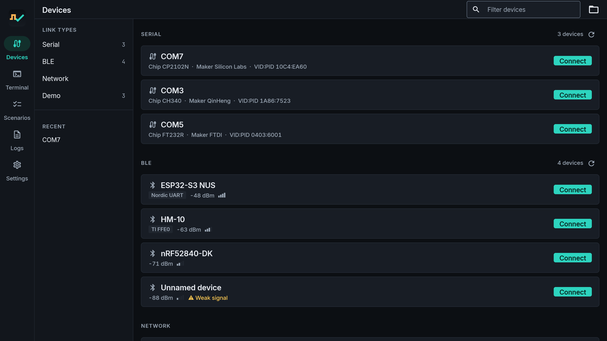
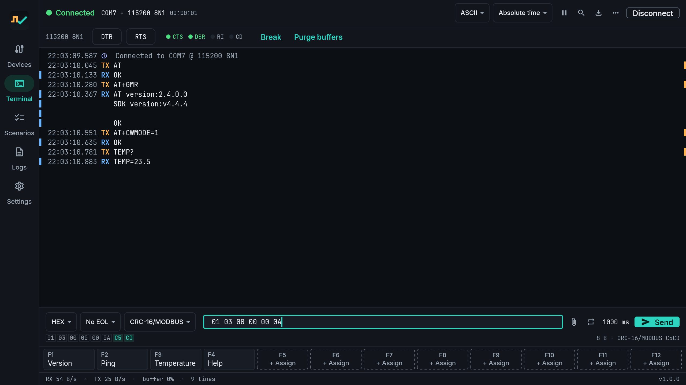
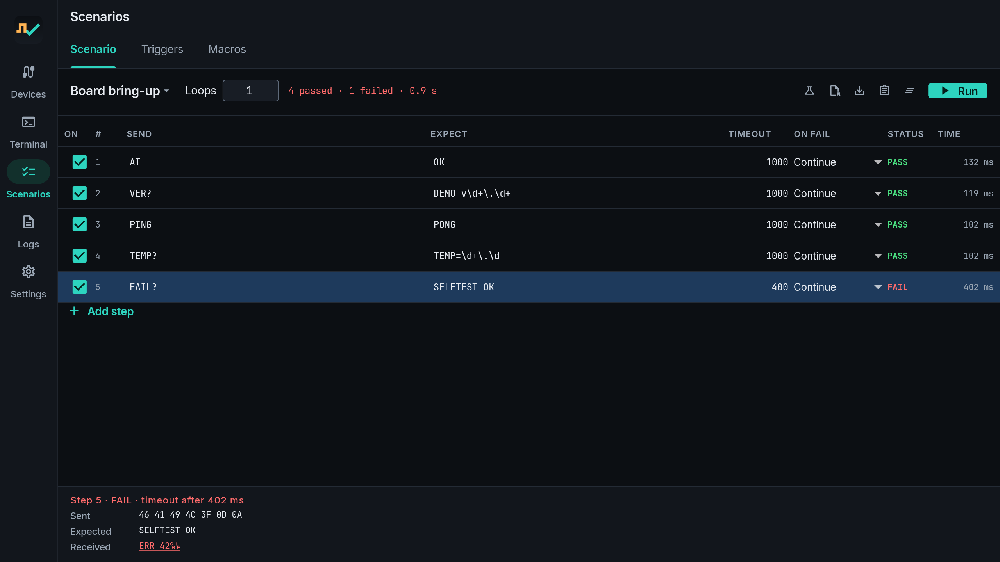
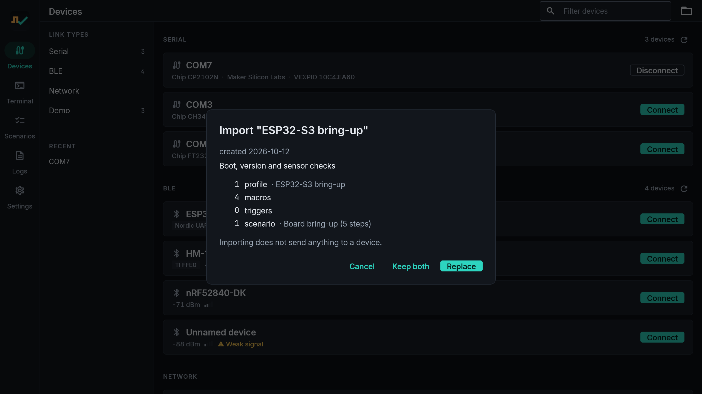

<h1 align="center">LinkJig</h1>

<b>A serial tool built for repeatable device testing, not just a terminal.</b>

Windows · Android

LinkJig talks to your hardware over a serial port, USB HID, Bluetooth Low Energy or TCP, all in one
terminal. It is made for embedded developers, hardware testers and makers who send the same commands
again and again: turn them into a scenario once, then run it on every board and get PASS or FAIL.

| Connect | Byte preview |
|---|---|
|  |  |
| **Scenario PASS/FAIL** | **One pack, desktop and phone** |
|  |  |

Screenshots taken with the built-in demo device.

## Features

- One terminal for serial (USB-UART), USB HID (Windows), Bluetooth LE and TCP; joins a module's own Wi-Fi first
- Live byte preview before sending, with checksum and CRC bytes highlighted
- Send ASCII with escape sequences, HEX, decimal or binary, with your own line ending
- Automatic baud-rate finder and modem line LEDs (DTR, RTS, CTS, DSR, RI)
- Ready BLE UART profiles (Nordic UART, HM-10, Microchip) and a GATT explorer
- Built-in demo device: try everything without hardware
- Macros, highlight rules, search, timestamps, response time after each send
- Scenarios: repeatable PASS/FAIL tests with expected replies, checksum checks and run history
- Triggers: automatic replies to incoming packets
- Logs and export, session sharing, one project pack that opens on desktop and phone
- Interface in English, Turkish, German, Spanish and Portuguese

Pro (free, see [Pricing](#pricing)) adds scenarios and triggers on real devices, periodic and file
send, automatic logging, rich export, more profiles and, on Android, more macros and highlight rules.

## Download

- **Windows:** [Microsoft Store](https://apps.microsoft.com/detail/9P1LHTD4C96V)
- **Android:** [Google Play](https://play.google.com/store/apps/details?id=io.github.linkjig)

## Quick start

1. Open **Devices** and pick a link type (or **Demo** if you have no hardware yet).
2. Connect, then type in the send bar; the preview shows the exact bytes.
3. Save the commands you repeat as macros or as a scenario and run it on every board.

## Pricing

- **Windows:** free. No ads, no purchases.
- **Android:** the tool itself has no ads. An optional mini game (Start Bit) shows ads. Pro is free:
  reach level 15 in the game, or watch short videos.
- Pro on Windows is unlocked with a free code from the Android app.

## Known limitations

- No iOS, macOS or Linux version.
- Android: no classic Bluetooth (SPP) and no USB HID yet.
- Tested on real hardware so far: CP2102 and CH340 USB-UART (Windows, Android OTG), ESP32 (serial and BLE),
  Ai-Thinker BL602 (BLE, TCP), ESP-01S and ESP-12E (Wi-Fi TCP, AT), Nuvoton M467 (USB HID). FTDI adapters are built in but not yet
  tested on hardware.

## Privacy and support

- [Privacy policy](https://linkjig.github.io/privacy.html) · [FAQ](https://linkjig.github.io/faq.html)
- Bugs and requests: [Issues](../../issues/new/choose) · Questions and ideas: [Discussions](../../discussions)
- E-mail: linkjig.app@gmail.com

This repository holds the website, the in-app pack library and these documents. The app itself is
closed source.

